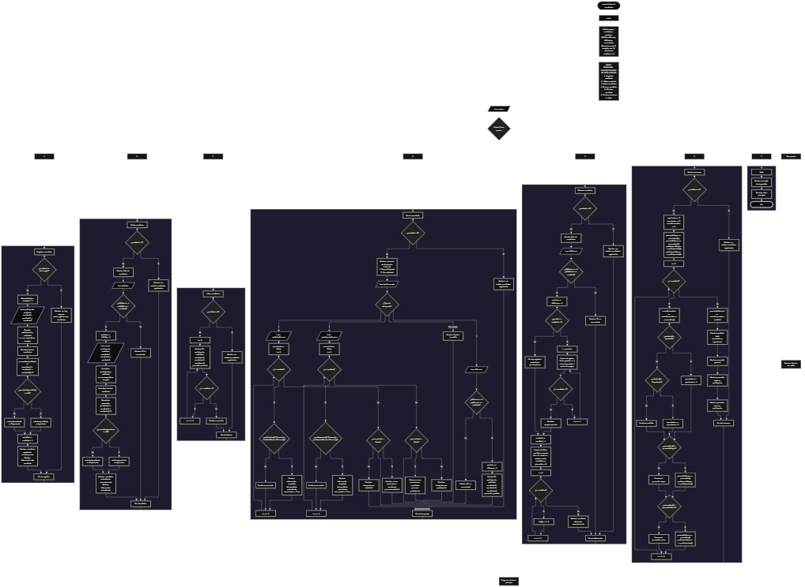

Este proyecto, llamado <b>concentrador de resultados</b>, fue desarrollado en <b>visual basic .net</b> como un ejercicio práctico para fortalecer la lógica de programación mediante la creación de un sistema de gestión de resultados desde la consola. El programa cuenta con un menú principal de siete opciones que permite <b>registrar, editar, eliminar, buscar, listar y consultar estadísticas</b> de los resultados almacenados. Cada registro contiene información del participante, la actividad realizada, tres resultados numéricos, el promedio calculado y su estado de aprobación. Para organizar esta información se utilizan ocho arreglos paralelos con una capacidad máxima de <b>10 registros durante la ejecución</b>. Durante su desarrollo se aplicaron conceptos fundamentales de programación, como variables, arreglos, estructuras condicionales, ciclos repetitivos y estructuras de selección, además de operaciones matemáticas, búsquedas, reorganización de registros y cálculos estadísticos.

<h2 align="center">⚙️ Funcionamiento del menú principal</h2>

### ➕ Registrar resultado

La opción <b>1) registrar resultado</b> permite almacenar un nuevo registro en el sistema. Antes de realizar el registro, el programa comprueba que la cantidad de resultados almacenados sea menor que la capacidad máxima de los arreglos, utilizando la condición <b>cantidad &lt; ids.Length</b>. Si existe espacio disponible, genera automáticamente un identificador mediante la asignación <b>ids(cantidad) = cantidad + 1</b> y solicita el <b>nombre del participante, la actividad y tres resultados numéricos</b>. Los datos se almacenan en sus respectivos arreglos. Posteriormente, calcula el promedio de los tres resultados mediante la fórmula <b>(resultado1 + resultado2 + resultado3) / 3</b>. Después, determina automáticamente el estado del participante: si el promedio es mayor o igual a <b>60</b>, establece el estado <b>"Aprobado"</b>; de lo contrario, asigna <b>"Reprobado"</b>. Finalmente, aumenta la variable <b>cantidad</b> en uno, muestra el mensaje <b>"Resultado registrado correctamente."</b> y presenta toda la información del registro. Si los arreglos alcanzan su capacidad máxima, muestra el mensaje <b>"No hay espacio para registrar mas resultados."</b>.

### ✏️ Editar resultado

La opción <b>2) editar resultado</b> permite modificar la información de un participante registrado. Primero, el programa comprueba si existen resultados almacenados mediante la variable <b>cantidad</b>. Si no hay registros, muestra el mensaje <b>"No existen resultados registrados."</b>. En caso contrario, presenta una lista con el ID, participante, actividad, los tres resultados, promedio y estado de cada registro. Después, solicita el ID del resultado que se desea editar y comprueba que se encuentre dentro del rango permitido mediante la condición <b>idEditar &gt;= 1 y idEditar &lt;= cantidad</b>. Si el ID es válido, obtiene la posición correspondiente utilizando <b>posicion = idEditar - 1</b>. A continuación, solicita el nuevo participante, actividad y los tres resultados numéricos, actualizando los datos almacenados en los arreglos correspondientes. Una vez modificados los valores, vuelve a calcular el promedio y determina nuevamente el estado de aprobación utilizando el límite de <b>60</b>. Finalmente, muestra el mensaje <b>"Resultado actualizado correctamente."</b> y presenta la información actualizada. Si el ID no corresponde a un registro existente, muestra el mensaje <b>"ID no encontrada."</b>.

### 📋 Listar resultados

La opción <b>3) listar resultados</b> permite visualizar todos los resultados registrados actualmente en el sistema. Antes de mostrar la información, el programa comprueba si la variable <b>cantidad</b> es igual a cero. Si no existen registros, presenta el mensaje <b>"No existen resultados registrados."</b>. Si hay información disponible, utiliza un ciclo <b>For</b> para recorrer los arreglos desde la posición <b>0</b> hasta <b>cantidad - 1</b>. Durante el recorrido, muestra el ID, nombre del participante, actividad, los tres resultados numéricos, promedio y estado correspondiente a cada registro. Esta opción facilita consultar toda la información almacenada sin necesidad de buscar los participantes individualmente.

### 🔎 Buscar resultado

La opción <b>4) buscar resultado</b> permite localizar registros mediante tres modalidades de búsqueda: <b>por ID, por participante y por actividad</b>. Primero, el programa comprueba si existen resultados registrados. Si no hay información disponible, muestra el mensaje <b>"No existen resultados registrados."</b>. En caso contrario, presenta un submenú para seleccionar el tipo de búsqueda.

La primera modalidad permite buscar por <b>ID</b>. El programa solicita el identificador del resultado y comprueba que se encuentre entre <b>1 y cantidad</b>. Si es válido, obtiene directamente la posición mediante <b>posicion = idBuscar - 1</b> y muestra toda la información del registro. Si el ID no existe, presenta el mensaje <b>"ID no encontrada."</b>.

La segunda modalidad permite buscar por <b>participante</b>. Para ello, solicita el nombre y utiliza la variable lógica <b>encontrado</b>, inicializada en <b>False</b>. Después, recorre el arreglo <b>participantes</b> mediante un ciclo <b>For</b> y compara cada nombre con el valor introducido utilizando <b>ToLower()</b>, lo que permite realizar comparaciones sin distinguir entre mayúsculas y minúsculas. Cuando encuentra una coincidencia, muestra todos los datos del resultado y cambia <b>encontrado</b> a <b>True</b>. Si termina el recorrido sin encontrar coincidencias, presenta el mensaje <b>"No se encontraron resultados para ese participante."</b>.

La tercera modalidad permite buscar por <b>actividad</b>. El programa solicita el nombre de la actividad y realiza un recorrido del arreglo <b>actividades</b>, comparando los valores mediante <b>ToLower()</b>. Cuando encuentra una coincidencia, muestra el registro completo y actualiza la variable <b>encontrado</b>. Si no encuentra ninguna coincidencia, presenta el mensaje <b>"No se encontraron resultados para esa actividad."</b>. Tanto la búsqueda por participante como por actividad pueden mostrar varios registros coincidentes. Si se selecciona una opción diferente de las tres disponibles, muestra el mensaje <b>"Opcion no valida."</b>.

### 🗑️ Eliminar resultado

La opción <b>5) eliminar resultado</b> permite eliminar un registro mediante su identificador. Primero, el programa comprueba si existen resultados almacenados. Si no hay registros, muestra el mensaje <b>"No existen resultados registrados."</b>. Si hay información disponible, presenta una lista con los datos de todos los participantes y solicita el ID del resultado que se desea eliminar. Después, verifica que el identificador esté dentro del rango permitido mediante la condición <b>idEliminar &gt;= 1 y idEliminar &lt;= cantidad</b>. Si el ID es válido, obtiene la posición correspondiente mediante <b>posicion = idEliminar - 1</b> y utiliza un ciclo <b>For</b> para desplazar una posición hacia atrás los registros posteriores en los ocho arreglos: <b>ids, participantes, actividades, resultados1, resultados2, resultados3, promedios y estados</b>. Posteriormente, disminuye la variable <b>cantidad</b> en uno y limpia la última posición ocupada, asignando <b>0</b> a los valores numéricos y una cadena vacía a los valores de texto. Finalmente, utiliza otro ciclo <b>For</b> para renumerar los identificadores desde <b>1</b> hasta la cantidad actual de registros y muestra el mensaje <b>"Resultado eliminado correctamente."</b>. Si el ID no corresponde a un registro existente, presenta el mensaje <b>"ID no encontrada."</b>.

### 📊 Mostrar resumen

La opción <b>6) mostrar resumen</b> permite consultar estadísticas generales de los resultados registrados. Primero, el programa comprueba si existen registros almacenados. Si la cantidad es igual a cero, muestra el mensaje <b>"No existen resultados registrados."</b>. En caso contrario, inicializa los contadores <b>aprobados y reprobados</b>, el acumulador <b>sumaPromedios</b> y las variables destinadas a identificar el promedio mayor y menor. También almacena los nombres de los participantes asociados inicialmente a esos valores.

Después, utiliza un ciclo <b>For</b> para recorrer los promedios y estados de todos los registros. Durante el recorrido, acumula los promedios en la variable <b>sumaPromedios</b>. Mediante estructuras condicionales, comprueba si cada participante tiene el estado <b>"Aprobado"</b> o <b>"Reprobado"</b>, aumentando el contador correspondiente. Asimismo, compara cada promedio con las variables <b>promedioMayor</b> y <b>promedioMenor</b> para identificar el valor más alto y el más bajo. Cuando encuentra un promedio superior o inferior, actualiza el valor correspondiente y almacena el nombre del participante asociado. Al finalizar el recorrido, calcula el promedio general mediante <b>sumaPromedios / cantidad</b> y presenta la cantidad total de resultados, participantes aprobados y reprobados, promedio general, promedio mayor y promedio menor, incluyendo los nombres de los participantes correspondientes.

### 🚪 Salir del menú principal

La opción <b>7) salir</b> permite finalizar la ejecución del programa. Cuando el usuario selecciona esta opción, se muestra el mensaje <b>"Gracias por utilizar Concentrador de Resultados."</b>. El menú principal se encuentra dentro de una estructura repetitiva <b>Do While</b>, que mantiene el programa en funcionamiento mientras la variable <b>opcion</b> sea diferente de <b>7</b>. Cuando se selecciona esta opción, la condición del ciclo deja de cumplirse y el programa termina correctamente.

<h2 align="center">🧠 Temas aplicados en el proyecto</h2>

### 📦 Variables

En este proyecto se utilizan variables para controlar la cantidad de resultados registrados, almacenar la opción seleccionada en el menú, recorrer los arreglos, identificar los registros que se desean modificar o eliminar, realizar búsquedas y calcular estadísticas. También se utilizan variables auxiliares para almacenar temporalmente los datos introducidos por el usuario, controlar las coincidencias y determinar los promedios mayores y menores.

🔢 **Opcion:** Almacena la opción seleccionada por el usuario en el menú principal.

📊 **Cantidad:** Controla la cantidad actual de resultados registrados.

🔄 **I:** Funciona como contador en los ciclos `For` y permite recorrer las posiciones de los arreglos.

🔎 **IdEditar:** Almacena el identificador del resultado que se desea modificar.

🔍 **IdBuscar:** Almacena el identificador del resultado que se desea consultar.

🗑️ **IdEliminar:** Almacena el identificador del resultado que se desea eliminar.

📌 **Posicion:** Permite obtener el índice correspondiente al identificador seleccionado.

🔎 **TipoBusqueda:** Almacena la modalidad de búsqueda seleccionada por el usuario.

📝 **ParticipanteBuscar:** Almacena el nombre del participante que se desea localizar.

📚 **ActividadBuscar:** Almacena el nombre de la actividad que se desea localizar.

✅ **Encontrado:** Variable lógica que indica si se encontró una coincidencia durante las búsquedas.

📊 **Aprobados y reprobados:** Contadores utilizados para calcular la cantidad de participantes en cada estado.

➕ **SumaPromedios:** Acumula los promedios de todos los registros para calcular el promedio general.

🏆 **PromedioMayor y promedioMenor:** Almacenan los valores más alto y más bajo encontrados durante el análisis.

👤 **ParticipanteMayor y participanteMenor:** Almacenan los nombres de los participantes asociados a los promedios mayor y menor.

### 🗃️ Arreglos

En este proyecto se utilizan ocho arreglos paralelos para almacenar la información de los resultados. Cada arreglo tiene una capacidad de <b>10 posiciones</b> y utiliza el mismo índice para representar los datos correspondientes a un mismo registro. Por ejemplo, la información del participante almacenado en la posición <b>0</b> se encuentra distribuida entre <b>ids(0), participantes(0), actividades(0), resultados1(0), resultados2(0), resultados3(0), promedios(0) y estados(0)</b>. Esta organización permite registrar, consultar, modificar, eliminar y analizar los resultados de manera ordenada.

🆔 **Ids(10):** Almacena los identificadores de los resultados registrados.

👤 **Participantes(10):** Almacena los nombres de los participantes.

📚 **Actividades(10):** Almacena los nombres de las actividades realizadas.

🔢 **Resultados1(10):** Almacena el primer resultado numérico de cada participante.

🔢 **Resultados2(10):** Almacena el segundo resultado numérico de cada participante.

🔢 **Resultados3(10):** Almacena el tercer resultado numérico de cada participante.

📊 **Promedios(10):** Almacena el promedio calculado a partir de los tres resultados.

📌 **Estados(10):** Almacena el estado de cada participante, que puede ser aprobado o reprobado.

### 🔀 Estructuras condicionales

En este proyecto se utilizan las estructuras <b>If, ElseIf y Else</b> para tomar decisiones según las condiciones de cada operación. Estas estructuras permiten comprobar si existe espacio disponible antes de registrar un resultado, verificar si hay registros almacenados, validar los identificadores antes de editar o eliminar, determinar si un participante aprobó o reprobó según su promedio y comprobar si se encontraron coincidencias durante las búsquedas. También permiten identificar los promedios mayores y menores al realizar el resumen estadístico.

### 🔄 Estructuras repetitivas

En este proyecto se utilizan los ciclos <b>Do While</b> y <b>For</b>. El ciclo <b>Do While</b> mantiene activo el menú principal mientras el usuario no seleccione la opción <b>7</b>. Por otro lado, los ciclos <b>For</b> permiten recorrer los arreglos para mostrar los resultados registrados, realizar búsquedas por participante o actividad, desplazar los registros durante la eliminación y calcular las estadísticas generales. También se utilizan para renumerar los identificadores después de eliminar un resultado.

### 🎯 Estructura select case

El programa utiliza la estructura <b>Select Case</b> para evaluar el valor almacenado en la variable <b>opcion</b> y ejecutar el bloque de instrucciones correspondiente a cada alternativa del menú principal. Cada caso representa una operación específica del sistema: <b>registrar, editar, listar, buscar, eliminar, mostrar resumen o salir</b>. También se utiliza <b>Case Else</b> para mostrar el mensaje <b>"Opcion no valida."</b> cuando el usuario introduce un número que no corresponde a ninguna de las opciones disponibles.

### 🔢 Dimensionamiento de arreglos

El programa utiliza la declaración <b>Dim</b> para definir ocho arreglos con diez posiciones cada uno. Por ejemplo, la instrucción <b>Dim ids(9) As Integer</b> establece un arreglo cuyos índices van desde <b>0 hasta 9</b>, permitiendo almacenar hasta diez identificadores. La misma capacidad se aplica a los demás arreglos. La cantidad de posiciones ocupadas se controla mediante la variable <b>cantidad</b>, por lo que las operaciones recorren únicamente los registros almacenados durante la ejecución.

### 🔄 Reorganización de registros

Cuando se elimina un resultado, el programa utiliza un ciclo <b>For</b> que comienza en la posición seleccionada y continúa hasta <b>cantidad - 2</b>. En cada repetición, los datos de la posición siguiente se copian sobre la posición actual en los ocho arreglos. Después, disminuye la variable <b>cantidad</b>, limpia la última posición ocupada y utiliza otro ciclo para renumerar los identificadores desde <b>1</b> hasta la cantidad actual de registros. Este procedimiento permite mantener los resultados organizados y evita dejar espacios vacíos entre los registros activos.

### 📐 Cálculo de promedios y clasificación

El programa utiliza operaciones aritméticas para calcular el promedio de cada participante a partir de tres resultados numéricos. La fórmula aplicada consiste en sumar los tres valores y dividir el resultado entre <b>3</b>. Después, mediante una estructura condicional, determina automáticamente el estado de cada participante: si el promedio es mayor o igual a <b>60</b>, se clasifica como <b>"Aprobado"</b>; si es inferior a ese valor, se clasifica como <b>"Reprobado"</b>. Este cálculo se realiza tanto al registrar un nuevo resultado como al editar uno existente.

### 📊 Contadores, acumuladores y estadísticas

Para generar el resumen general, el programa utiliza contadores y acumuladores que permiten analizar la información registrada. Los contadores <b>aprobados</b> y <b>reprobados</b> registran la cantidad de participantes en cada categoría, mientras que el acumulador <b>sumaPromedios</b> reúne todos los promedios para obtener el promedio general. Además, las variables <b>promedioMayor</b> y <b>promedioMenor</b> permiten identificar los valores extremos y almacenar los nombres de los participantes correspondientes. De esta manera, el sistema proporciona una visión general del rendimiento de los participantes.

<h2 align="center">¿Cómo se implementaron las operaciones crud en el proyecto?</h2>

Las operaciones <b>crud</b> se implementaron mediante las opciones del menú principal, permitiendo administrar los resultados registrados. La operación <b>crear</b> corresponde a <b>registrar resultado</b>, donde se almacena un nuevo participante junto con su actividad y los tres resultados numéricos; <b>leer</b> se realiza mediante las opciones <b>buscar resultado, listar resultados y mostrar resumen</b>, que permiten consultar los registros y sus estadísticas; <b>actualizar</b> corresponde a <b>editar resultado</b>, donde se modifican los datos de un participante y se recalculan su promedio y estado; y <b>eliminar</b> se realiza mediante la opción <b>eliminar resultado</b>, que retira un registro y reorganiza los datos de los ocho arreglos. Estas operaciones utilizan variables, arreglos, estructuras condicionales y ciclos para administrar la información temporalmente durante la ejecución del programa.

<h2 align="center">Diagrama de flujo del proyecto</h2>

<h2 align="center">🛡️ Validaciones del programa</h2>

### 📭 No existen resultados registrados

Esta validación se utiliza en las opciones de <b>editar, listar, buscar, eliminar y mostrar resumen</b>. El programa comprueba si la variable <b>cantidad</b> es igual a <b>0</b>. Si no existen resultados almacenados, muestra el mensaje <b>"No existen resultados registrados."</b> y evita continuar con las operaciones que necesitan información registrada.

### ⚠️ Capacidad máxima alcanzada

Esta validación se utiliza durante el registro de nuevos resultados para controlar la capacidad de los arreglos. El programa comprueba si <b>cantidad &gt;= ids.Length</b> antes de permitir almacenar un nuevo registro. Como los arreglos tienen diez posiciones, el sistema admite un máximo de <b>10 resultados</b>. Cuando se alcanza esa cantidad, muestra el mensaje <b>"No hay espacio para registrar mas resultados."</b> e impide agregar otro registro.

### ❌ ID no encontrada

Esta validación se utiliza en las operaciones de <b>editar, buscar por ID y eliminar</b>. El programa comprueba que el identificador introducido sea mayor o igual a <b>1</b> y menor o igual a la variable <b>cantidad</b>. Si el ID se encuentra dentro del rango permitido, obtiene su posición correspondiente restando uno al identificador. Si el valor introducido no corresponde a un registro existente, muestra el mensaje <b>"ID no encontrada."</b>.

### 🔎 Resultado no encontrado

Esta validación se utiliza durante las búsquedas por participante y actividad. El programa inicializa la variable lógica <b>encontrado</b> con el valor <b>False</b> y recorre los arreglos correspondientes para comparar los datos almacenados con el valor introducido. Si encuentra una coincidencia, cambia la variable a <b>True</b> y muestra el registro correspondiente. Si finaliza el recorrido sin encontrar coincidencias, muestra el mensaje <b>"No se encontraron resultados para ese participante."</b> o <b>"No se encontraron resultados para esa actividad."</b>, según el tipo de búsqueda realizado.

### 📊 Clasificación de participantes

Esta validación se realiza automáticamente al registrar o editar un resultado. El programa calcula el promedio de los tres valores y comprueba si es mayor o igual a <b>60</b>. Si cumple la condición, asigna el estado <b>"Aprobado"</b>; en caso contrario, establece <b>"Reprobado"</b>. De esta manera, el estado se actualiza de acuerdo con los resultados numéricos almacenados, sin necesidad de solicitarlo directamente al usuario.

### ⚠️ Opción inválida

La estructura <b>Select Case</b> incluye el bloque <b>Case Else</b>, que muestra el mensaje <b>"Opcion no valida."</b> cuando el usuario introduce un número que no corresponde a ninguna de las opciones definidas en el menú principal. De esta manera, el programa informa cuando se selecciona una alternativa que no está disponible.

### ⚠️ Entradas numéricas y resultados

El programa utiliza <b>Convert.ToInt32</b> y <b>Convert.ToDouble</b> para convertir los valores introducidos por el usuario en números enteros y decimales. Sin embargo, no incluye un control de excepciones para entradas no numéricas ni comprueba que los tres resultados se encuentren dentro de un rango específico. Por tanto, se espera que el usuario introduzca valores numéricos válidos para que las operaciones puedan ejecutarse correctamente.

<h2 align="center">🎯 Objetivo del proyecto</h2>

El objetivo principal de este proyecto es fortalecer la <b>lógica de programación</b> mediante el desarrollo de un sistema de gestión y análisis de resultados en <b>visual basic .net</b>. A través de su construcción se busca aplicar los conocimientos adquiridos sobre variables, arreglos, estructuras condicionales, ciclos repetitivos y estructuras de selección, integrándolos con operaciones matemáticas y cálculos estadísticos. Además, el proyecto permite comprender cómo registrar, consultar, modificar y eliminar información, calcular promedios, clasificar participantes e identificar estadísticas generales mediante una aplicación de consola.

